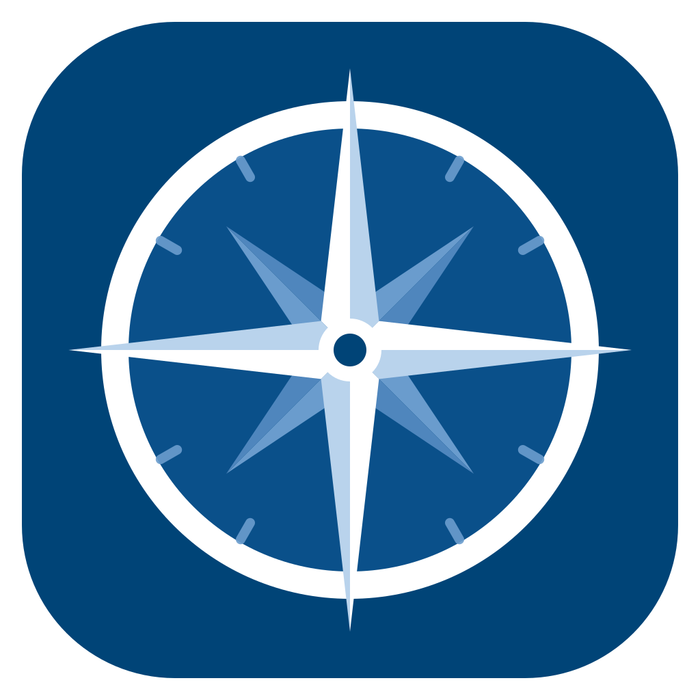
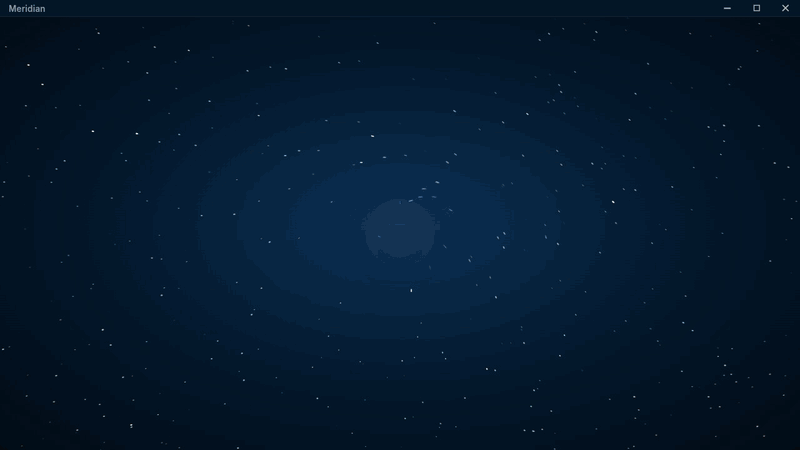

<p align="center"></p>

<h1 align="center">Meridian</h1>

<p align="center">
   <a href="../../README.md">English</a> ·
   <a href="README.ru.md">Русский</a> ·
   <b>Українська</b> ·
   <a href="README.be.md">Беларуская</a> ·
   <a href="README.kk.md">Қазақ тілі</a> ·
   <a href="README.de.md">Deutsch</a> ·
   <a href="README.fr.md">Français</a> ·
   <a href="README.es.md">Español</a>
</p>

<p align="center"><b>Лаунчер для Minecraft з модами.</b> Оберіть сервер і натисніть «Грати»: Java, завантажувач модів, моди та налаштування встановляться й оновлюватимуться самі.</p>

<p align="center">
  <a href="https://github.com/ildimas/Helios-Custom-Worlds/releases/latest"></a>
  <a href="https://github.com/ildimas/Helios-Custom-Worlds/actions/workflows/build.yml"></a>
  <a href="https://github.com/ildimas/Helios-Custom-Worlds/releases"></a>
</p>

<p align="center"></p>


---

Meridian — форк [Helios Launcher](https://github.com/dscalzi/HeliosLauncher) з новим інтерфейсом, підтримкою збірок і перекладами. Список серверів береться з власного індексу дистрибуції (`distribution.json`, створюється за допомогою [Nebula](https://github.com/dscalzi/Nebula)), а гравці можуть додавати до нього свої збірки.

## Можливості

* 🔐 **Акаунти**
  * Вхід через Microsoft (OAuth 2.0) і Mojang, кілька акаунтів зі швидким перемиканням.
  * Гра без входу під будь-яким ніком — для серверів із вимкненим `online-mode`.
* 🧭 **Сервери**
  * Перемикач серверів на головному екрані: версія Minecraft, версія збірки та кількість гравців онлайн.
  * Файли перевіряються перед кожним запуском; відсутні та пошкоджені завантажуються знову.
  * Можна ввімкнути автопідключення до сервера під час запуску гри.
* 📦 **Збірки**
  * Пошук і встановлення збірок з **Modrinth** і **CurseForge** (для CurseForge потрібен безкоштовний API-ключ).
  * Імпорт `.mrpack`, `.zip` від CurseForge та експортів Prism / MultiMC перетягуванням.
  * Будь-яка версія Minecraft з **Forge**, **NeoForge**, **Fabric** або **Quilt**.
* 🧩 **Моди та паки**
  * Обов'язкові, необов'язкові та drop-in моди.
  * Шейдерпаки й ресурспаки вмикаються та вимикаються в налаштуваннях.
* ☕ **Java**
  * Заздалегідь встановлювати не потрібно: якщо відповідної Java немає, лаунчер встановить її сам.
  * Повзунок пам'яті, власний виконуваний файл і аргументи JVM.
* 🖼️ **Оформлення**
  * У кожної збірки свої шпалери, що змінюються: арт збірки, ваші скриншоти з гри (F2) або кадри з галереї Photon Shaders із зазначенням авторів.
  * Налаштовуються інтервал зміни та плавний рух; апаратне прискорення можна вимкнути.
* 🌍 **Мови**
  * Русский, English, Українська, Беларуская, Қазақ тілі, Deutsch, Français, Español. Інші в роботі.
  * Перемикаються миттєво, можуть слідувати мові системи й виставляти ту саму мову в Minecraft.
* 🌐 **Проксі** — HTTP або SOCKS5 для входу й завантажень, за бажанням і для самої гри.
* 🔄 **Автооновлення** — коли виходить нова версія, лаунчер питає, завантажити її зараз чи пізніше, сам встановлює й перезапускається зі збереженими налаштуваннями. На macOS працює, якщо лаунчер лежить у «Програмах».
* 📰 Новини, статус сервісів Mojang і Discord Rich Presence.

## Завантажити

Інсталятор для своєї системи беріть у [Releases](https://github.com/ildimas/Helios-Custom-Worlds/releases/latest).

| Платформа | Файл |
| --- | --- |
| Windows x64 | `Meridian-setup-VERSION.exe` |
| macOS Intel | `Meridian-setup-VERSION-x64.dmg` |
| macOS Apple Silicon | `Meridian-setup-VERSION-arm64.dmg` |
| Linux x64 | `Meridian-setup-VERSION.AppImage` |
| Debian / Ubuntu | `Meridian-setup-VERSION.deb` |
| Arch Linux | `Meridian-setup-VERSION.pacman` |

Попередні версії отримують лише ті, у кого ввімкнено **«Отримувати попередні версії»** в Налаштування → Лаунчер.

## Консоль

Консоль DevTools відкривається поєднанням `Ctrl + Shift + I`. Щоб зберегти лог, клацніть у консолі правою кнопкою й оберіть **Save as…**.

> [!WARNING]
> Нічого не вставляйте в консоль, якщо не впевнені, що саме це зробить: так можна віддати доступ до свого акаунта.

## Розробка

Потрібен [Node.js](https://nodejs.org/) 22.

```console
git clone https://github.com/ildimas/Helios-Custom-Worlds.git
cd Helios-Custom-Worlds
npm install
npm start
```

Збирання інсталяторів:

| Ціль | Команда |
| --- | --- |
| Поточна платформа | `npm run dist` |
| Windows x64 | `npm run dist:win` |
| macOS | `npm run dist:mac` |
| Linux x64 | `npm run dist:linux` |

Для macOS зазвичай потрібен Mac. На Linux `./build.sh` однією командою встановлює залежності й запускає лаунчер (`--build` — розпакований застосунок, `--package` — пакети).

Якщо запушити в `master` нову `version` у `package.json`, GitHub Actions збере всі платформи й опублікує реліз.

### Документація

* [Релізи, оновлення, новини та збірки](../releases-news-and-modpacks.md) (російською)
* [Індекс дистрибуції](../distro.md) (англійською)
* [Авторизація Microsoft](../MicrosoftAuth.md) (англійською)
* [Як додати арт збірки](../../app/assets/images/modpacks/README.md)

### Переклади

Рядки лежать у [`app/assets/lang`](../../app/assets/lang): вихідний файл — `en_US.toml`, решта перевизначають лише те, що перекладено (неперекладені рядки показуються англійською). Назва й посилання на соцмережі — у `_custom.toml`.

## Подяки

* [Helios Launcher](https://github.com/dscalzi/HeliosLauncher) від Daniel Scalzi, ліцензія MIT, див. [LICENSE.txt](../../LICENSE.txt).
* Шпалери з [галереї Photon Shaders](https://modrinth.com/shader/photon-shader/gallery), автори перелічені в [CREDITS.md](../../app/assets/images/wallpapers/CREDITS.md).

Meridian не пов'язаний з Mojang AB і Microsoft.
